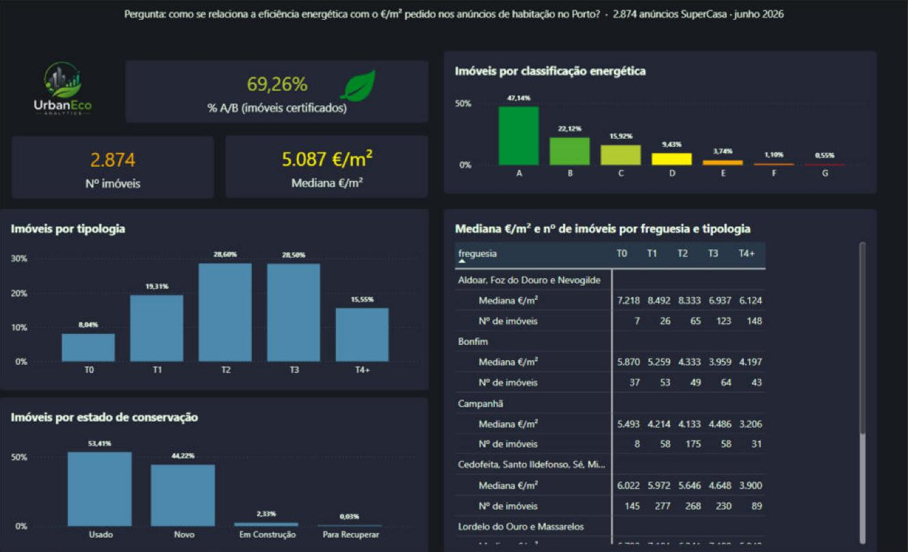

# UrbanEco Analytics — eficiência energética e preço da habitação no Porto

**Pergunta:** como se relaciona a eficiência energética com o preço por m² pedido nos anúncios de habitação no Porto?

Projeto final de grupo da Pós-Graduação em Big Data & Decision Making (ISEP, 2026). Este repositório é mantido por mim, Andressa Avelar Belo. Contém o código de recolha e tratamento de dados, a documentação do dashboard Power BI e a revisão feita em outubro de 2026.



---

## Resultados principais

Base: os 2.874 anúncios de venda do dashboard (portal SuperCasa, concelho do Porto, junho de 2026). Medianas de €/m²; classe NT excluída das comparações entre classes. São preços pedidos, não preços de venda.

| # | Resultado | Números |
|---|---|---|
| 1 | **A localização pesa mais do que a classe energética.** | A mediana do €/m² vai de 4.180 (Campanhã) a 6.950 (Aldoar, Foz do Douro e Nevogilde), +66%. Num T1, vai de 4.214 a 8.492 €/m². |
| 2 | **Sem segmentar, a classe quase não distingue preços.** | Medianas: A 5.259 · B 5.439 · C 4.938 · D 4.735 €/m². Nos T0, T1 e T2, a classe A fica abaixo da B. |
| 3 | **Na mesma freguesia e tipologia, os imóveis A/B pedem mais por m².** | 15 em 15 segmentos (≥ 20 anúncios por grupo), com uma diferença mediana de +766 €/m². Só nos usados: 18 em 19 segmentos, +1.183 €/m². |
| 4 | **A amostra está enviesada para imóveis eficientes.** | 91% da obra nova certificada é A/B, contra 50% dos usados. |
| 5 | **Associação, não causalidade.** | A diferença de preço pode refletir a idade, os acabamentos, o andar ou a vista do imóvel. |

---

## Pipeline

```
SuperCasa (anúncios de venda, Porto)
   → recolha com Python + Selenium
   → limpeza e normalização com Python/pandas
       · preço e área convertidos para números
       · €/m² calculado e filtrado entre 500 e 25.000
       · freguesias agrupadas nas 7 uniões de 2013
       · remoção de duplicados por URL
   → PostgreSQL
       · local, em Docker (scripts deste repositório)
       · base partilhada do grupo na Aiven (fonte do dashboard)
   → Power BI (Power Query + DAX, 7 páginas)
```

### Os números de cada etapa

| Etapa | Anúncios | Onde |
|---|---|---|
| Recolha final (21–22/06/2026) | 2.805 | dataset de recolha (não publicado) |
| Depois da limpeza em Python (29 removidos por €/m² fora de 500–25.000; 0 duplicados) | 2.776 | `scripts/calcular_evi.py` |
| Base do grupo usada pelo dashboard (21–26/06/2026, IDs únicos) | 2.874 | dashboard Power BI |

Os 2.776 e os 2.874 vêm de duas cargas quase iguais: 2.773 anúncios são comuns às duas. A mediana é de 5.057 €/m² no primeiro conjunto e de 5.087 €/m² no segundo.

### Dois índices EVI

O projeto tem duas versões do Energy Value Index:

- **Python (`calcular_evi.py`), escala 1–10:** `(energy_score × 0,55 + price_score × 0,45) × 9 + 1`. O `price_score` compara o €/m² de cada anúncio com a mediana do seu segmento (freguesia × tipologia, com pelo menos 3 anúncios). A mediana do índice é 6,7, sobre 2.612 anúncios.
- **Dashboard (DAX), escala 0–100:** `(Price Score × 0,4 + Energy Score × 0,3 + Location Score × 0,3) × 20`. Inclui um índice verde por freguesia. O EVI médio é 59,46, sobre 2.678 anúncios.

Os pesos de ambos os índices são escolhas do projeto, não foram estimados a partir dos dados.

---

## Dashboard Power BI

São 7 páginas: Visão Geral, Oportunidades de Negócio, EVI, Serviços por Freguesia, Prémio Verde, Conclusões e Metodologia.

- Fórmulas DAX: [`docs/medidas_dax.md`](docs/medidas_dax.md)
- Metodologia, filtros e limitações: [`docs/metodologia.md`](docs/metodologia.md)
- O ficheiro `.pbix` não é publicado, porque contém os dados recolhidos.

### Revisão de outubro de 2026

O dashboard do grupo foi revisto em outubro de 2026. As correções foram:

| Problema encontrado | Correção |
|---|---|
| O card "Prémio total G → A" somava os prémios de todos os segmentos (14.772 €/m²). | Passou a mostrar a média dos segmentos com ≥ 20 anúncios: B → A = 338 €/m². |
| O EVI dava nota energética 0 aos 148 anúncios sem certificado (NT) e price score 0 aos 54 anúncios sem mediana de segmento. | O EVI fica em branco quando falta uma componente. O EVI médio passou de 57,90 para 59,46. |
| O card "Melhor freguesia" usava `MAX` sobre texto e devolvia a última freguesia por ordem alfabética. | Passou a usar a freguesia com ranking 1. |
| Nos gráficos de serviços por freguesia, a barra maior correspondia à pior posição. | Passaram a mostrar uma pontuação: 8 − posição. |
| Havia filtros escondidos em alguns visuais e KPIs com a média de €/m². | Os filtros foram documentados e os KPIs passaram a usar a mediana. |

---

## Estrutura do repositório

```
urbaneco-analytics/
├── src/ingestion/scrape_properties_selenium.py   # scraper SuperCasa (Selenium)
├── scripts/calcular_evi.py                       # limpeza, €/m², segmentos, EVI (Python)
├── scripts/02_load_to_postgres.py                # carga para PostgreSQL local
├── sql/01_create_database.sql
├── sql/01_create_tables.sql                      # dim_energy, dim_parish, fact_listings
├── docker-compose.yml                            # PostgreSQL 16 local
├── docs/medidas_dax.md
├── docs/metodologia.md
└── docs/img/visao_geral.png
```

---

## Como executar

Os dados recolhidos **não são publicados**, para respeitar os termos de utilização do portal de origem. Os scripts esperam encontrar o dataset em `data/raw/`.

```bash
cp .env.example .env              # preencher DB_NAME, DB_USER, DB_PASSWORD
docker compose up -d              # PostgreSQL 16 local
pip install -r requirements.txt
python scripts/calcular_evi.py    # gera os CSV em data/processed/
```

Requer Python 3.11 ou superior. O scraper usa o Chrome, com o ChromeDriver gerido pelo `webdriver-manager`.

---

## Limitações

- São preços pedidos nos anúncios, não preços de transação.
- Há uma única recolha (junho de 2026) e só no concelho do Porto.
- O dashboard depende da base de dados do grupo e não é atualizável fora dela.
- Há possíveis anúncios repetidos com IDs diferentes: 695 anúncios formam 263 grupos com características iguais, a maioria de obra nova. Foram mantidos, porque não alteram a mediana.
- Os resultados mostram associação, não causalidade.

---

## Autoria

Projeto final de grupo: Pós-Graduação em Big Data & Decision Making, ISEP, 2026.

**A minha contribuição:**
- recolha dos dados (scraping do SuperCasa com Python/Selenium);
- limpeza e cálculo do EVI em Python;
- base PostgreSQL local em Docker;
- documentação do projeto;
- revisão do dashboard em outubro de 2026.

As medidas DAX originais e a base PostgreSQL na Aiven foram desenvolvidas pelo grupo.

**Andressa Avelar Belo** · [LinkedIn](https://linkedin.com/in/andressaavelar) · [GitHub](https://github.com/aavelarbelo)
